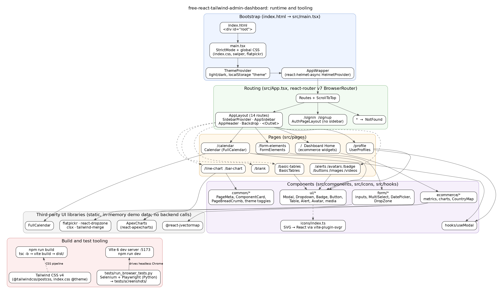

# Architecture

This document describes the TailAdmin React dashboard as it exists on `main` in the COG-GTM fork: a client-only React 19 + TypeScript single-page app styled with Tailwind CSS v4 and built with Vite, plus a Python browser test suite that COG-GTM added under `tests/`.



The diagram source is [`diagrams/architecture.dot`](diagrams/architecture.dot) (Graphviz). After editing it, run [`diagrams/render.sh`](diagrams/render.sh) to regenerate [`architecture.png`](diagrams/architecture.png) and [`architecture.svg`](diagrams/architecture.svg). It needs Graphviz (`apt-get install graphviz fonts-dejavu`).

## At a glance

| Concern | Implementation |
| --- | --- |
| UI framework | React 19 (`react`, `react-dom`), TypeScript 5.7 in `strict` mode |
| Routing | `react-router` v7 `BrowserRouter`, defined in `src/App.tsx` |
| Styling | Tailwind CSS v4 via `@tailwindcss/postcss`; tokens and utilities in `src/index.css` |
| Global state | Two React contexts: `ThemeContext` and `SidebarContext` |
| Data | Hard-coded demo data inside components; no API calls, no backend, no auth |
| Build | Vite 6 (`@vitejs/plugin-react`, `vite-plugin-svgr`); `npm run build` = `tsc -b && vite build` |
| Tests | Python Selenium + Playwright smoke tests in `tests/`; no JS unit tests, no CI workflow |

## Repository layout

```
index.html              HTML shell; mounts the app on <div id="root"> and loads /src/main.tsx
vite.config.ts          React plugin + svgr (SVGs imported with ?react become React components)
postcss.config.js       @tailwindcss/postcss
eslint.config.js        typescript-eslint, react-hooks and react-refresh rules
tsconfig*.json          app (src/) and node (vite.config.ts) projects, built with tsc -b
public/                 favicon and static images served from /images/...
src/
  main.tsx              bootstrap: StrictMode, global CSS, ThemeProvider, AppWrapper, App
  App.tsx               every route
  index.css             Tailwind import, @theme tokens, dark variant, menu/scrollbar utilities,
                        third-party CSS overrides (ApexCharts, FullCalendar, flatpickr, jVectorMap)
  context/              ThemeContext.tsx, SidebarContext.tsx
  layout/               AppLayout, AppSidebar, AppHeader, Backdrop, SidebarWidget
  pages/                one component per route (Dashboard, Calendar, Forms, Tables, Charts,
                        UiElements, AuthPages, OtherPage/NotFound, Blank, UserProfiles)
  components/           reusable building blocks (see "Components")
  hooks/                useModal, useGoBack
  icons/                SVG files plus index.ts re-exporting them as React components
tests/                  COG-GTM browser test suite (see "Browser test suite")
docs/                   this document and its diagram
```

## Bootstrap

`index.html` loads `src/main.tsx`, which renders:

```
<StrictMode>
  <ThemeProvider>          light/dark theme, persisted in localStorage["theme"]
    <AppWrapper>           react-helmet-async HelmetProvider (per-page <title>/<meta>)
      <App />              router
```

`main.tsx` also imports the global stylesheets: `src/index.css`, `swiper/swiper-bundle.css` and `flatpickr/dist/flatpickr.css`. `index.html` has no `<title>`. Each page renders `PageMeta` (`src/components/common/PageMeta.tsx`), which sets `<title>` and `<meta name="description">` through `react-helmet-async`. In practice, with React 19 the title is set reliably only on a full page load: after client-side navigation the browser usually keeps the previous page's title.

## Routing

All routes live in `src/App.tsx`. `ScrollToTop` sits inside the router and scrolls to the top on every path change.

| Group | Path | Page component |
| --- | --- | --- |
| `AppLayout` (sidebar + header) | `/` | `pages/Dashboard/Home` |
| | `/profile` | `pages/UserProfiles` |
| | `/calendar` | `pages/Calendar` |
| | `/blank` | `pages/Blank` |
| | `/form-elements` | `pages/Forms/FormElements` |
| | `/basic-tables` | `pages/Tables/BasicTables` |
| | `/alerts`, `/avatars`, `/badge`, `/buttons`, `/images`, `/videos` | `pages/UiElements/*` |
| | `/line-chart`, `/bar-chart` | `pages/Charts/*` |
| Auth (full-screen, no sidebar) | `/signin`, `/signup` | `pages/AuthPages/SignIn`, `SignUp` (both use `AuthPageLayout`) |
| Fallback | `*` | `pages/OtherPage/NotFound` |

The 14 `AppLayout` routes are nested under a pathless `<Route element={<AppLayout />}>`, which renders the active page through `<Outlet />`. The sidebar's "404 Error" link points to `/error-404`, which has no route of its own and is served by the `*` fallback.

## Layout and global state

`src/layout/AppLayout.tsx` wraps its content in `SidebarProvider` and renders:

- `AppSidebar`: the navigation menu. Its items are two static arrays (`navItems`: Dashboard, Calendar, User Profile, Forms, Tables, Pages; `othersItems`: Charts, UI Elements, Authentication). It highlights the item matching `location.pathname` and opens the submenu that contains it. It expands on hover when collapsed.
- `AppHeader`: sidebar toggle (desktop collapse or mobile drawer), a search box focused by Ctrl/Cmd+K, `ThemeToggleButton`, `NotificationDropdown` and `UserDropdown` (whose "Sign out" links to `/signin`).
- `Backdrop`: on mobile, an overlay that closes the open sidebar drawer.
- The page itself, inside a padded `max-w-(--breakpoint-2xl)` container.

There are two contexts and no other state library:

| Context | State | Notes |
| --- | --- | --- |
| `ThemeContext` (`src/context/ThemeContext.tsx`) | `theme`, `toggleTheme()` | Reads/writes `localStorage["theme"]` and toggles the `dark` class on `<html>`. Tailwind's `dark:` variant is defined in `index.css` as `@custom-variant dark (&:is(.dark *))`. |
| `SidebarContext` (`src/context/SidebarContext.tsx`) | `isExpanded`, `isMobileOpen`, `isHovered`, `toggleSidebar()`, `toggleMobileSidebar()`, ... | Below 768 px wide it reports `isExpanded=false` and closes the mobile drawer when the window grows. Only available inside `AppLayout`. |

Page-level state (calendar events, form values, modal visibility) is local `useState`. `useModal` (`src/hooks/useModal.ts`) returns `{ isOpen, openModal, closeModal, toggleModal }` and backs the edit modals on the profile and calendar pages.

## Pages

| Page | What it renders |
| --- | --- |
| Dashboard Home | `EcommerceMetrics`, `MonthlySalesChart`, `MonthlyTarget`, `StatisticsChart`, `DemographicCard` (with `CountryMap`), `RecentOrders` from `components/ecommerce/` |
| Calendar | FullCalendar (day grid, time grid, interaction plugins) seeded with three in-memory events; clicking a date or event opens a `Modal` to add or edit an event. Events are not persisted. |
| User Profile | `UserMetaCard`, `UserInfoCard`, `UserAddressCard`, each with an edit `Modal` |
| Form Elements | the `components/form/form-elements/*` demos: inputs, `DatePicker` (flatpickr), `MultiSelect`, checkboxes, radios, toggles, file input, `DropZone` (react-dropzone), input states |
| Basic Tables | `BasicTableOne` built from the `ui/table` primitives with `Badge` and avatar cells |
| Line / Bar Chart | `LineChartOne` / `BarChartOne` (ApexCharts) inside a `ComponentCard` |
| UI Elements | demos of `Alert`, `Avatar`, `Badge`, `Button`, image grids and responsive video embeds |
| Sign In / Sign Up | static forms (`components/auth/`); they do not submit anywhere |
| Blank, NotFound | placeholder page and 404 page |

Every page sets its title with `PageMeta`; most `AppLayout` pages also render `PageBreadcrumb`.

## Components

`src/components/` is grouped by purpose:

| Folder | Contents |
| --- | --- |
| `ui/` | Generic primitives: `modal` (Escape to close, body scroll lock), `dropdown` (`Dropdown`, `DropdownItem`), `badge`, `button`, `table` (`Table`, `TableHeader`, `TableBody`, `TableRow`, `TableCell`), `alert`, `avatar`, `images`, `videos` |
| `form/` | `Label` (uses `clsx` + `tailwind-merge`), `Select`, `MultiSelect`, `date-picker` (flatpickr wrapper), `input/*`, `switch/Switch`, `group-input/PhoneInput`, and the `form-elements/*` demo cards |
| `ecommerce/` | Dashboard widgets; charts use `react-apexcharts`, `CountryMap` uses `@react-jvectormap/core` + `world` |
| `charts/` | `LineChartOne`, `BarChartOne` |
| `common/` | `PageMeta`/`AppWrapper`, `PageBreadcrumb`, `ComponentCard`, `ScrollToTop`, `ThemeToggleButton` (header), `ThemeTogglerTwo` (auth pages), `GridShape`, `ChartTab` |
| `header/` | `NotificationDropdown`, `UserDropdown` (`Header.tsx` here is not imported; the live header is `layout/AppHeader.tsx`) |
| `UserProfile/`, `auth/`, `tables/` | Page-specific cards and forms |

Icons are SVG files in `src/icons/`. `src/icons/index.ts` imports each one as `import { ReactComponent as XIcon } from "./x.svg?react"`; `vite-plugin-svgr` (configured in `vite.config.ts` with `exportType: "named"`) turns them into React components and `src/svg.d.ts` types the `?react` imports.

All charts, tables, maps and lists use hard-coded sample data. The app calls no APIs. The only external requests are the Outfit font from Google Fonts (imported at the top of `index.css`) and, on `/videos`, the YouTube `<iframe>` embeds in `components/ui/videos/`.

## Styling

`src/index.css` is the single stylesheet:

- `@import "tailwindcss"` (processed by `@tailwindcss/postcss` through `postcss.config.js`).
- `@theme { ... }`: the design tokens (Outfit font, breakpoints, `brand`/`gray`/`success`/`error`/`warning`/... color scales, text sizes, shadows, z-indices).
- `@custom-variant dark`: class-based dark mode tied to `ThemeContext`.
- `@utility` blocks for sidebar menu items (`menu-item*`, `menu-dropdown-*`) and scrollbars (`no-scrollbar`, `custom-scrollbar`).
- Overrides for ApexCharts, FullCalendar, flatpickr, jVectorMap and Swiper so they follow the theme.

## Build and tooling

| Command | What it does |
| --- | --- |
| `npm install` (or `npm ci`) | Installs dependencies. `package.json` `overrides` widen the React peer range of `react-helmet-async` and `@react-jvectormap/*` to accept React 19. |
| `npm run dev` | Vite dev server on http://localhost:5173 |
| `npm run build` | `tsc -b` type-checks both TS projects, then `vite build` writes `dist/` (a single ~1.9 MB JS chunk) |
| `npm run preview` | Serves `dist/` locally |
| `npm run lint` | ESLint over the repo (ignores `dist`) |

There is no CI workflow, no pre-commit hook and no JavaScript unit test runner in the repository.

## Browser test suite

COG-GTM added `tests/` (see [`tests/README.md`](../tests/README.md)): Python smoke tests that drive the running dev server in headless Chrome.

| File | Role |
| --- | --- |
| `tests/requirements.txt` | `selenium`, `playwright`, `webdriver-manager`, `chromedriver-autoinstaller`, `requests` (+ optional pytest plugins) |
| `tests/run_browser_tests.py` | Changes to the repo root, creates `tests/screenshots/`, waits up to 30 s for http://localhost:5173, then runs each test file as a subprocess (120 s timeout) and prints a pass/fail summary; exit code 1 if either fails |
| `tests/e2e/test_selenium.py` | 1920x1080 headless Chrome via `chromedriver-autoinstaller`: asserts the title contains "TailAdmin", waits for `#root` to have children, counts sidebar/cards/charts, saves `selenium_screenshot.png`, clicks the first visible link |
| `tests/e2e/test_playwright.py` | Same checks with Playwright Chromium plus a full-page screenshot, hovering a link, a 768x1024 viewport screenshot and an attempt to click a theme toggle |

The tests are plain scripts (not pytest test functions) and assert only the page title and that React mounted; the other checks print warnings instead of failing. Screenshots go to `tests/screenshots/`, which `.gitignore` excludes.

Run them with the dev server up:

```bash
npm run dev                                  # terminal 1
python -m venv .venv && . .venv/bin/activate # terminal 2
pip install -r tests/requirements.txt
playwright install chromium
python tests/run_browser_tests.py
```

Known limitations of the suite on `main`:

- `chromedriver-autoinstaller` reads the version from `google-chrome --version`. With Chrome for Testing (which prints "Google Chrome for Testing 137...") it fails to parse the version and the Selenium test errors before opening a page. A regular Google Chrome install, or a `google-chrome` wrapper earlier on `PATH` that prints `Google Chrome <version>` for `--version`, avoids this.
- The Playwright dark-mode step looks for `[data-testid="theme-toggle"]`, `.theme-toggle` or a button whose `aria-label` mentions theme/dark. `ThemeToggleButton` has none of these, so the step is skipped silently and `playwright_dark_screenshot.png` is never written.
